# Infraestructura - Hardening, Seguridad L2, RADIUS y Monitoreo

## Video demostrativo

[Ver video en YouTube](https://www.youtube.com/watch?v=0Th1xWBT4P0)

## Propósito del laboratorio

Implementar y asegurar una infraestructura de red empresarial compuesta por un router Cisco (R1), un switch Cisco IOSvL2 (SW1), un controlador de dominio Windows Server (Active Directory y NPS), un servidor Linux Kali (cliente DHCP y Zabbix) y estaciones de usuario (PC1). Se configuran mecanismos de seguridad en Capa 2 (Port-Security), acceso administrativo restringido por SSHv2, autenticación centralizada mediante RADIUS con contingencia local en el switch, servidor DHCP en R1, monitoreo SNMP con Zabbix y un script de auditoría de hardening basado en las directrices CIS para Cisco IOS.

## Topología

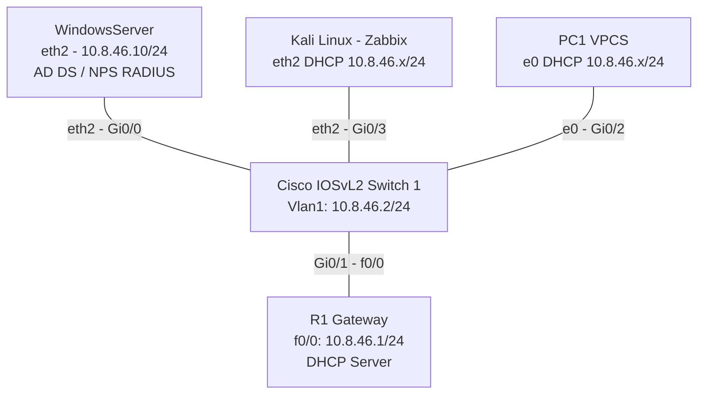

## Plan de direccionamiento

Base 10.8.46.0/24 (matrícula 20250846).

| Equipo | Interfaz | IP / Prefijo | Función |
|---|---|---|---|
| R1 | FastEthernet0/0 | 10.8.46.1/24 | Gateway LAN y servidor DHCP |
| SW1 | Vlan1 | 10.8.46.2/24 | Gestión, cliente RADIUS y SNMP |
| WindowsServer | eth2 | 10.8.46.10/24 | Active Directory y NPS (RADIUS Server) |
| Kali | eth2 | DHCP (10.8.46.0/24) | Monitoreo Zabbix y ejecución de script CIS |
| PC1 | e0 | DHCP (10.8.46.0/24) | Host LAN de pruebas y validación |
| Pool DHCP | LAN_CLIENTES | 10.8.46.21 - 10.8.46.254 | Excluidos: 10.8.46.1 - 10.8.46.20 |

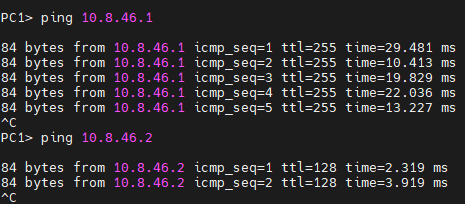

## Seguridad en puertos (Port-Security)

Configuración de port-security en los puertos de acceso del switch (interfaz Gi0/2 hacia PC1) con un máximo de 2 direcciones MAC aprendidas dinámicamente (`sticky`) y modo de violación en `shutdown`.

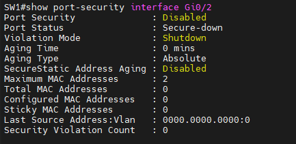

## Zabbix cliente DHCP y monitoreo SNMP

Kali obtiene su dirección IP de forma dinámica mediante DHCP desde R1. R1 y SW1 cuentan con agente SNMPv2c configurado con comunidad de solo lectura (`RO`), permitiendo la recolección de métricas desde el panel de Zabbix.

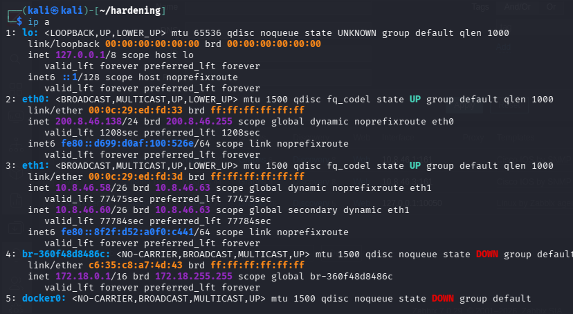

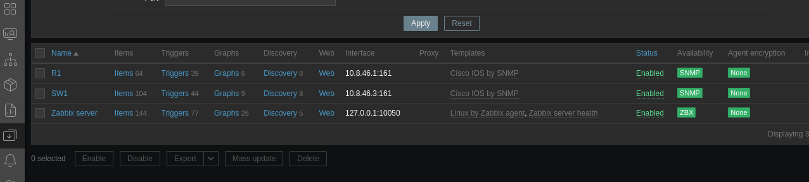

## Acceso administrativo por SSH

Se restringe el acceso en las líneas VTY de R1 y SW1 para aceptar exclusivamente SSHv2 (`transport input ssh`), con credenciales locales cifradas mediante algoritmos de hash y deshabilitando el protocolo Telnet.

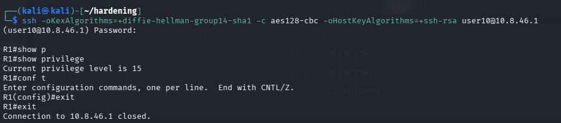

## Servidor DHCP en R1

El router entrega direccionamiento dinámico a los clientes de la LAN (Kali y PC1), reservando el rango de infraestructura y servidores estáticos (`10.8.46.1` al `10.8.46.20`).

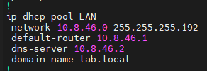

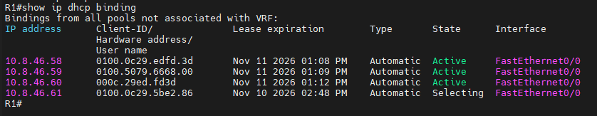

## Script de informe de hardening CIS

Script en Python (`scripts/conectar_r1.py`) que conecta por SSH a R1 y analiza el `running-config` contra recomendaciones seleccionadas del CIS Cisco IOS Benchmark en modo de solo lectura (sin modificar la configuración). Genera el reporte estructurado en consola y en archivo de texto.

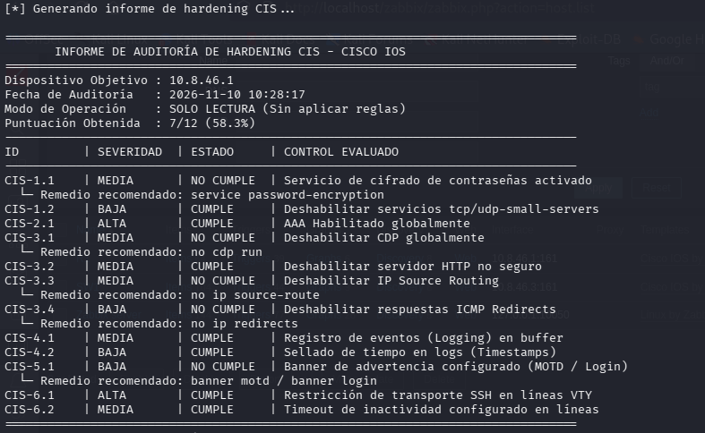

- Script ejecutado: [`scripts/conectar_r1.py`](scripts/conectar_r1.py)
- Reporte generado: [`scripts/informe_hardening_r1.txt`](scripts/informe_hardening_r1.txt)

## Switch como cliente RADIUS

SW1 está integrado con Network Policy Server (NPS) y Active Directory en Windows Server (10.8.46.10). Se autentica y autoriza el acceso administrativo vía RADIUS, manteniendo configurado el usuario local como respaldo en caso de fallo del servidor.

### Inicio de sesión con usuario de Active Directory:
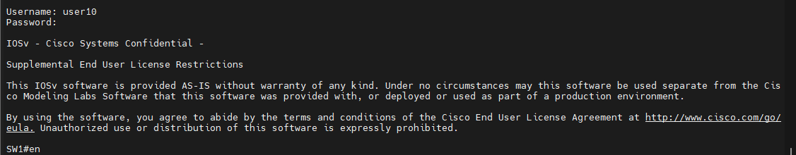

### Inicio de sesión de contingencia con usuario local:
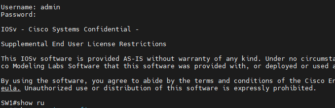

## Running-configs

- [`configs/R1_running.txt`](configs/R1_running.txt)
- [`configs/SW1_running.txt`](configs/SW1_running.txt)
